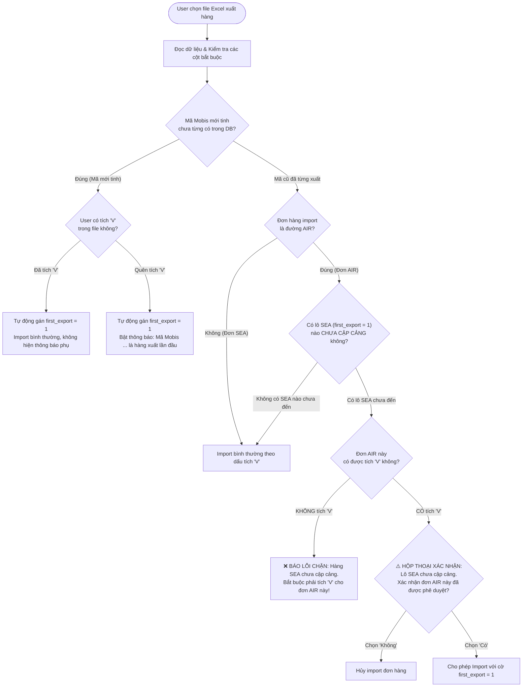

# QUY TRÌNH & LUỒNG HOẠT ĐỘNG CHỨC NĂNG XUẤT HÀNG
## (Hàng xuất lần đầu & Hàng thay đổi xuất lần đầu giữa SEA và AIR)

---

## 1. PHÂN BIỆT 2 KHÁI NIỆM NGHIỆP VỤ CỐT LÕI

| Tiêu chí | 1. Hàng xuất lần đầu | 2. Hàng thay đổi xuất lần đầu |
|:---|:---|:---|
| **Bản chất** | **Mã Mobis hoàn toàn mới xuất xưởng hoặc đang trong vòng đời xuất lần đầu** (chưa từng có lô hàng nào cập cảng thành công trong quá khứ). | **Mã Mobis đã từng xuất xưởng và đã cập cảng thành công từ trước (mã cũ)**, đợt này có sự thay đổi thiết kế, khuôn mẫu, ECN... nên người dùng **tích "V"** ở cột *First Export*. |
| **Khi Import file** | • **Mã mới:** Tự động gán `first_export = 1`. Nếu user **quên tích "V"**, hệ thống hiện thông báo: *"Mã Mobis ... là hàng xuất lần đầu và đã được tự động đánh dấu First Export"*. Nếu user đã tích "V" thì không hiện thông báo phụ.<br>• **Đơn xuất AIR khi có lô SEA đi trước chưa cập cảng:** Bắt buộc user phải tích "V" (nếu không tích $\rightarrow$ báo lỗi chặn). Nếu có tích "V" $\rightarrow$ Hiện hộp thoại hỏi phê duyệt (Có/Không). | • Gán `first_export = 1` nếu có tích "V".<br>• **Đơn xuất AIR khi có lô SEA đổi chưa cập cảng:** Tương tự, bắt buộc phải tích "V" (nếu không tích $\rightarrow$ báo lỗi chặn). Nếu có tích "V" $\rightarrow$ Hiện hộp thoại hỏi phê duyệt (Có/Không). |
| **Khi Quét mã (Scan)** | • **Đơn xuất đầu tiên:** Bật popup thông báo 1 lần ở **thùng đầu tiên** (Nếu đi SEA: hiển thị số ngày cập cảng đỏ; Nếu đi AIR: hiển thị chữ "AIR" xanh). Tiêu đề: **"HÀNG XUẤT LẦN ĐẦU"**.<br>• **Các đơn SEA thứ 2, 3 tiếp theo:** Quét mượt mà, **KHÔNG bật popup**.<br>• **Đơn xuất AIR khi có lô SEA chưa cập cảng:** Bật popup cảnh báo ở **thùng đầu tiên** của MỖI đơn AIR với tiêu đề: **"HÀNG XUẤT LẦN ĐẦU"** kèm số ngày còn lại của lô biển. | • **Đơn xuất đầu tiên của đợt thay đổi (tích V):** Bật popup thông báo 1 lần ở **thùng đầu tiên** (Nếu đi SEA: số ngày cập cảng; Nếu đi AIR: chữ "AIR"). Tiêu đề: **"HÀNG THAY ĐỔI XUẤT LẦN ĐẦU"**.<br>• **Các đơn SEA thứ 2, 3 tiếp theo:** Quét mượt mà, **KHÔNG bật popup**.<br>• **Đơn xuất AIR khi có lô SEA chưa cập cảng:** Bật popup cảnh báo ở **thùng đầu tiên** của MỖI đơn AIR với tiêu đề: **"HÀNG THAY ĐỔI XUẤT LẦN ĐẦU"** kèm số ngày còn lại của lô biển. |
| **Ghi nhớ cảnh báo** | Ghi nhớ theo **`model_id`** (chỉ hiển thị popup ở thùng đầu tiên của mỗi đơn hàng, từ thùng thứ 2 quét liên tục). | Ghi nhớ theo **`model_id`** (chỉ hiển thị popup ở thùng đầu tiên của mỗi đơn hàng, từ thùng thứ 2 quét liên tục). |

---

## 2. QUY TRÌNH 2 KHÂU HOẠT ĐỘNG

### Khâu 1: Import File Excel (Kiểm tra kế hoạch)


### Khâu 2: Quét Mã Barcode (Khi xuất kho thực tế)
```mermaid
flowchart TD
    Scan([Công nhân quét mã QR thùng hàng]) --> CheckExist{Mã QR đã từng quét<br>trong ca/hệ thống chưa?}
    CheckExist -- Đã tồn tại --> ErrDup[Báo chuông lỗi: Mã QR đã tồn tại]
    CheckExist -- Hợp lệ --> FindOrder[Khớp đơn hàng trong kế hoạch]
    
    FindOrder --> CheckType{Đơn hàng thuộc nhóm nào?}
    
    CheckType -- Đơn xuất đầu tiên của Mã Mới Tinh --> CheckShown1{"Thùng đầu tiên<br>của đơn này?"}
    CheckShown1 -- Đúng --> AlertNewFirst[🚨 BẬT POPUP: 'HÀNG XUẤT LẦN ĐẦU'<br>• SEA: số ngày cập cảng (màu đỏ)<br>• AIR: chữ 'AIR' (màu xanh)]
    CheckShown1 -- Thùng thứ 2 trở đi --> ScanSmooth[Quét mượt mà, không lặp lại popup]
    
    CheckType -- Đơn xuất đầu tiên của Đợt Thay Đổi ECN --> CheckShown2{"Thùng đầu tiên<br>của đơn này?"}
    CheckShown2 -- Đúng --> AlertModFirst[🚨 BẬT POPUP: 'HÀNG THAY ĐỔI XUẤT LẦN ĐẦU'<br>• SEA: số ngày cập cảng (màu đỏ)<br>• AIR: chữ 'AIR' (màu xanh)]
    CheckShown2 -- Thùng thứ 2 trở đi --> ScanSmooth
    
    CheckType -- Đơn AIR xuất khi có lô SEA chưa cập cảng --> CheckShown3{"Thùng đầu tiên<br>của đơn này?"}
    CheckShown3 -- Đúng --> AlertAirSea[🚨 BẬT POPUP:<br>• Mã mới: 'HÀNG XUẤT LẦN ĐẦU'<br>• Mã cũ đổi: 'HÀNG THAY ĐỔI XUẤT LẦN ĐẦU'<br>Kèm số ngày còn lại của lô SEA]
    CheckShown3 -- Thùng thứ 2 trở đi --> ScanSmooth
    
    CheckType -- Đơn SEA đợt 2, 3 tiếp theo hoặc Đơn thường nhật --> NoAlert[Quét mượt mà, KHÔNG bật popup<br>Bảng danh sách hiển thị số ngày cập cảng]
    
    AlertNewFirst --> UpdateQty[Cập nhật số lượng & Lưu lịch sử quét]
    AlertModFirst --> UpdateQty
    AlertAirSea --> UpdateQty
    ScanSmooth --> UpdateQty
    NoAlert --> UpdateQty
    
    UpdateQty --> CheckComplete{Số lượng == Target?}
    CheckComplete -- Đạt Target --> CompleteOrder[Chuyển trạng thái sang Complete]
    CheckComplete -- Chưa đạt --> WaitNext[Chờ quét thùng tiếp theo]
```

---

## 3. BẢNG TỔNG HỢP CÁC TÌNH HUỐNG THỰC TẾ

| STT | Tình huống | Loại hàng & Phương thức | Khi Import File Excel | Khi Quét Barcode (Thùng 1) | Tiêu đề Popup khi quét |
|:---:|:---|:---:|:---|:---|:---:|
| **1** | **Mã mới - Đơn xuất đầu tiên (User quên tích V)** | `SEA` hoặc `AIR` | • Tự động gắn cờ $\checkmark$ First Export<br>• **Hiện thông báo:** *"Mã Mobis ... là hàng xuất lần đầu"* | 🚨 **HIỆN THÔNG BÁO 1 LẦN**<br>• SEA: Số ngày cập cảng đỏ<br>• AIR: Chữ "AIR" xanh | **"HÀNG XUẤT LẦN ĐẦU"** |
| **2** | **Mã mới - Đơn xuất đầu tiên (User đã tích V)** | `SEA` hoặc `AIR` | Tự động gắn cờ $\checkmark$ First Export (Không hiện thông báo phụ) | 🚨 **HIỆN THÔNG BÁO 1 LẦN**<br>• SEA: Số ngày cập cảng đỏ<br>• AIR: Chữ "AIR" xanh | **"HÀNG XUẤT LẦN ĐẦU"** |
| **3** | **Mã mới - Đơn thứ 2 trở đi (đi SEA)** | `SEA` (Đợt 1 biển chưa đến) | Import bình thường | **KHÔNG hiện popup** (bảng hiện ngày cập cảng đỏ) | Không có |
| **4** | **Mã mới - Đơn xuất AIR (Lô biển 1 chưa đến)** | `AIR` (Đợt 1 biển chưa đến) | • Nếu KHÔNG tích V: ❌ **Báo lỗi chặn import**<br>• Nếu CÓ tích V: ⚠️ **Hỏi phê duyệt (Có/Không)** | 🚨 **HIỆN POPUP CẢNH BÁO** (hiện số ngày còn lại của lô biển) | **"HÀNG XUẤT LẦN ĐẦU"** |
| **5** | **Mã mới - Đơn xuất tiếp AIR đợt sau (Lô biển 1 vẫn chưa đến)** | `AIR` (Đợt 1 biển chưa đến) | • Nếu KHÔNG tích V: ❌ **Báo lỗi chặn import**<br>• Nếu CÓ tích V: ⚠️ **Hỏi phê duyệt (Có/Không)** | 🚨 **HIỆN POPUP CẢNH BÁO** (ở thùng 1 của mỗi đơn AIR) | **"HÀNG XUẤT LẦN ĐẦU"** |
| **6** | **Mã mới - Đơn xuất AIR khi lô biển ĐÃ CẬP CẢNG XONG** | `AIR` (Lô biển 1 đã đến nơi) | Import bình thường | **KHÔNG hiện popup** (quét bình thường) | Không có |
| **7** | **Mã cũ đổi ECN - Đơn xuất đầu tiên của đợt đổi (tích V)** | `SEA` hoặc `AIR` | Import theo dấu tích 'V' | 🚨 **HIỆN THÔNG BÁO 1 LẦN**<br>• SEA: Số ngày cập cảng đỏ<br>• AIR: Chữ "AIR" xanh | **"HÀNG THAY ĐỔI XUẤT LẦN ĐẦU"** |
| **8** | **Mã cũ đổi ECN - Đơn thứ 2 trở đi (đi SEA)** | `SEA` | Import bình thường | **KHÔNG hiện popup** (quét bình thường) | Không có |
| **9** | **Mã cũ đổi ECN - Đơn xuất AIR (Lô biển đổi chưa đến)** | `AIR` (Lô biển đổi chưa đến) | • Nếu KHÔNG tích V: ❌ **Báo lỗi chặn import**<br>• Nếu CÓ tích V: ⚠️ **Hỏi phê duyệt (Có/Không)** | 🚨 **HIỆN POPUP CẢNH BÁO** (ở thùng 1 của mỗi đơn AIR) | **"HÀNG THAY ĐỔI XUẤT LẦN ĐẦU"** |
| **10** | **Mã cũ xuất thường nhật (không tích V)** | `AIR` hoặc `SEA` | Import bình thường | **KHÔNG hiện popup** (quét bình thường) | Không có |
